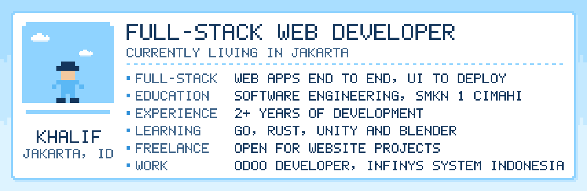
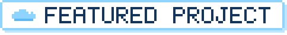
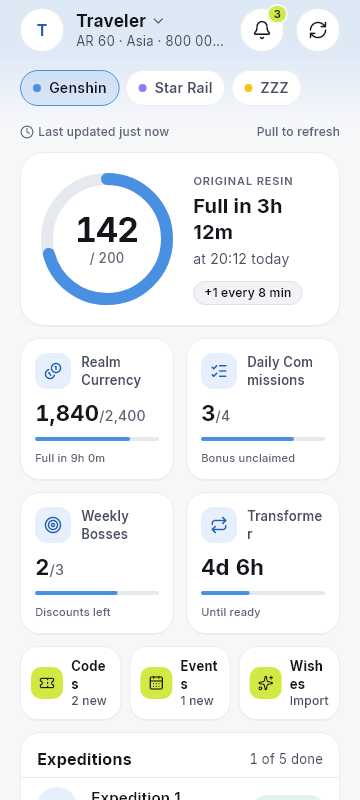
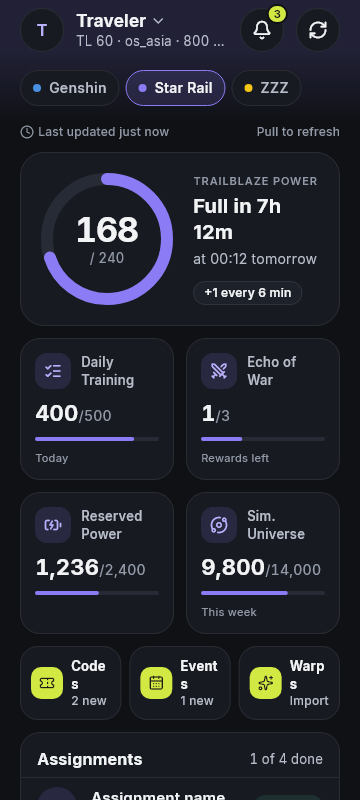
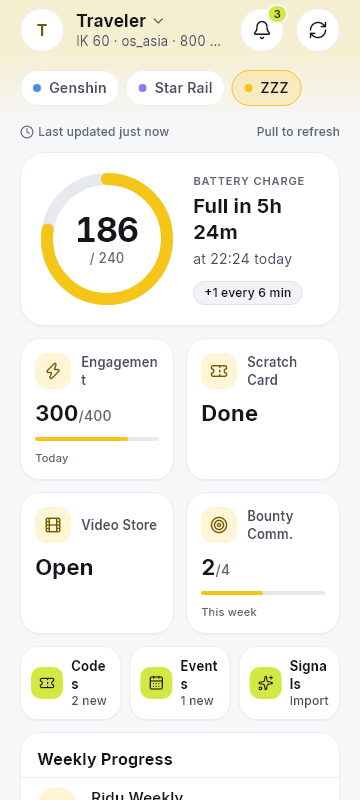
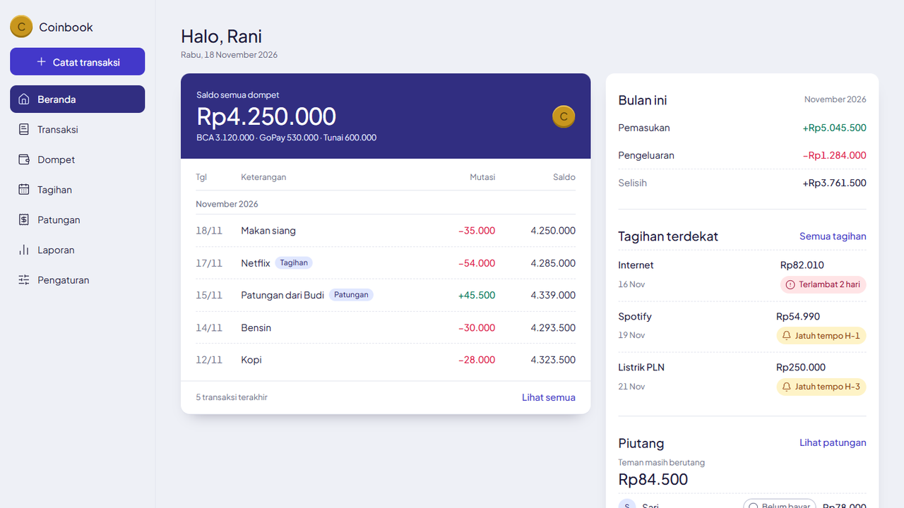

  

 

  

 

  

<table>
  <tr>
    <td><b>Frontend</b></td>
    <td></td>
  </tr>
  <tr>
    <td><b>Backend</b></td>
    <td></td>
  </tr>
  <tr>
    <td><b>Database</b></td>
    <td></td>
  </tr>
  <tr>
    <td><b>ERP and mobile</b></td>
    <td></td>
  </tr>
  <tr>
    <td><b>DevOps</b></td>
    <td></td>
  </tr>
  <tr>
    <td><b>Learning</b></td>
    <td></td>
  </tr>
</table>

   

<table>
  <tr>
    <td width="50%" valign="middle">
      
    </td>
    <td width="50%" valign="middle">
      <h3><a href="https://linkium.bio">Linkium</a></h3>
      
A link-in-bio platform for developers and designers. One URL becomes a portfolio with links, projects, resume and live analytics.

      <ul>
        <li><b>Links:</b> drag-and-drop ordering and a project showcase.</li>
        <li><b>Analytics:</b> visitors, clicks, CTR, referrers and devices.</li>
        <li><b>Themes:</b> live theme editor and QR code sharing.</li>
      </ul>
      Next.js · Hono · Cloudflare Workers · Drizzle · PostgreSQL
    </td>
  </tr>
</table>

<table>
  <tr>
    <td width="50%" align="center" valign="middle">
      
    </td>
    <td width="50%" valign="middle">
      <h3><a href="https://github.com/Khahaha10/Hoyo-AIO">HoYo AIO</a></h3>
      
      
Unofficial companion app for Genshin Impact, Honkai: Star Rail, Zenless Zone Zero and Honkai Impact 3rd. Stamina, daily check-in, codes, pity tracker and home-screen widgets in one place.

      <ul>
        <li><b>Dashboard:</b> stamina with time to full, dailies and expeditions, works offline.</li>
        <li><b>Check-in:</b> auto check-in for all four games and notifications before stamina overflows.</li>
        <li><b>Privacy:</b> no backend, data stays on the device, cookie encrypted twice.</li>
      </ul>
      Flutter · Dart · Riverpod · Drift (SQLite) · Kotlin · Swift
        
      <a href="https://github.com/Khahaha10/Hoyo-AIO/releases/latest">Download the APK</a>
    </td>
  </tr>
</table>

   

<table>
  <tr>
    <td width="50%" align="center" valign="top">
      
      <h3><a href="https://github.com/Khahaha10/coinbook">Coinbook</a></h3>
      
      
Personal finance app with wallets, bill reminders and split bills you can share with friends.

      Next.js · NestJS · Prisma · Supabase
    </td>
    <td width="50%" align="center" valign="top">
      
      <h3><a href="https://adikara.my.id">adikara.my.id</a></h3>
      
      
My portfolio site, a static Next.js build with Strapi as the CMS and a pixel-perfect design.

      Next.js · Tailwind CSS · Strapi
    </td>
  </tr>
</table>

<table>
  <tr>
    <th align="left">Project</th>
    <th align="left">Description</th>
  </tr>
  <tr>
    <td><b>HR mobile app for Odoo</b> Flutter · Riverpod · Dio · GoRouter</td>
    <td>Cross-platform (Android and iOS) HR app on top of Odoo 19.</td>
  </tr>
  <tr>
    <td><b>Polls</b> Next.js · Supabase · TanStack Query</td>
    <td>Poll builder with drag-and-drop questions, QR sharing and result charts.</td>
  </tr>
  <tr>
    <td><b>Landing page kit</b> Next.js · Tailwind CSS · Turborepo</td>
    <td>Monorepo of demo sites (coffee shop, car service, handmade store) on a shared UI package.</td>
  </tr>
  <tr>
    <td><b><a href="https://github.com/Khahaha10/Pengaduan-Masyarakat">Pengaduan Masyarakat</a></b> Laravel · MySQL · Sanctum</td>
    <td>Public complaint reporting system with PDF reports.</td>
  </tr>
  <tr>
    <td><b><a href="https://github.com/Khahaha10/E2E-Testing-Project-Pengaduan-Masyarakat">E2E Pengaduan Masyarakat</a></b> Playwright · Faker</td>
    <td>End-to-end test suite running in GitHub Actions.</td>
  </tr>
</table>

Projects without a link are private repositories.

   

  

   

  
  

  <picture>
    <source media="(prefers-color-scheme: dark)" srcset="https://raw.githubusercontent.com/Khahaha10/Khahaha10/output/snake-dark.svg">
    
  </picture>

   

<table>
  <tr>
    <td width="88"></td>
    <td><b>Games</b> I play ranked to unwind, and yes, I still rage quit sometimes.</td>
    <td width="88"></td>
    <td><b>Music</b> Hip hop and J-pop, usually playing while I code.</td>
  </tr>
  <tr>
    <td width="88"></td>
    <td><b>Style</b> I like sneakers and typography. It's the same eye I use for spacing in UI.</td>
    <td width="88"></td>
    <td><b>Anime</b> Mostly shows from 2015 and earlier, but I watch the new ones too.</td>
  </tr>
</table>

   

Have a website in mind? Let's talk at <a href="mailto:knurfattah@gmail.com">knurfattah@gmail.com</a>.

  
  
  

  
  

   

  

